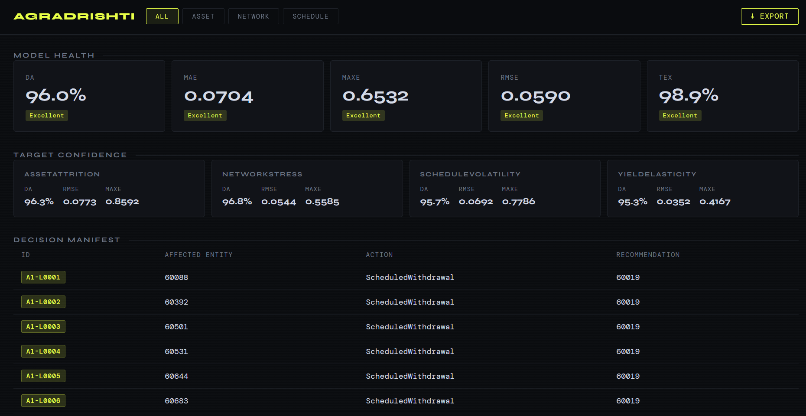
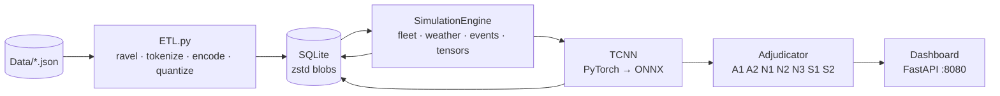
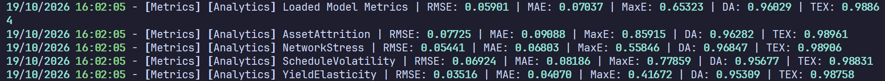
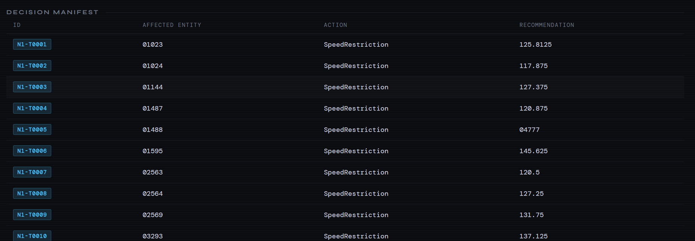
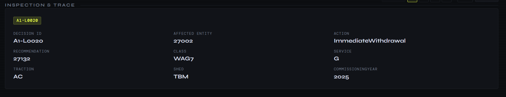

# Agradrishti

> *Agradrishti* (Sanskrit: *agra* "ahead, foremost" + *dṛṣṭi* "sight") - sight ahead of the event.

**Predictive operations intelligence for a railway network.** Agradrishti simulates an Indian Railways-scale network (18 zones, 5,689 stations, 11,274 segments, 63,648 weekly train runs), trains a Temporal CNN on weekly network tensors, and turns its forecasts into concrete, traceable operational decisions on a live dashboard.

```
ETL  →  builds the static world      ML  →  simulates, learns, decides      Dashboard  →  shows the decisions
```



---

## Results

Last full run, evaluated over the entire simulated window (312 weeks), forecasting 4 weeks ahead from an 8-week lookback. Errors are in de-standardized target units.

| Target               | RMSE    | MAE     | MaxE    | DA      | TEX     |
|----------------------|---------|---------|---------|---------|---------|
| **Overall**          | 0.05913 | 0.06821 | 0.58365 | 96.35%  | 98.85%  |
| AssetAttrition       | 0.07961 | 0.09410 | 0.81310 | 96.80%  | 98.94%  |
| NetworkStress        | 0.06777 | 0.07783 | 0.64803 | 96.54%  | 98.88%  |
| ScheduleVolatility   | 0.04677 | 0.05254 | 0.47230 | 96.24%  | 98.82%  |
| YieldElasticity      | 0.04236 | 0.04835 | 0.40115 | 95.83%  | 98.75%  |

**DA** = directional accuracy (did the model call the week-to-week move correctly). **TEX** = threshold exceedance agreement (did the model agree with the truth on whether a value exceeds +1σ).

### Scale of the simulated world

| Entity            | Count   | | Entity              | Count   |
|-------------------|---------|-|---------------------|---------|
| Engines           | 11,468  | | Segments            | 11,274  |
| Wagons            | 364,770 | | Stations            | 5,689   |
| Weekly train runs | 63,648  | | Timetables          | 13,717  |
| Events            | 482     | | Simulated weeks     | 312     |

### Decisions issued

| ID | Action                     | Count (last run)                                   |
|----|----------------------------|----------------------------------------------------|
| A1 | Scheduled / Immediate Withdrawal | Scheduled: 335 engines, 18,365 wagons · Immediate: 10 engines, 40,757 wagons |
| A2 | Loco Link                  | 3,183                                              |
| N1 | Speed Restriction          | 2,171                                              |
| N2 | Section Block              | 730                                                |
| N3 | Diversion                  | 2,250                                              |
| S1 | Crossing Priority          | 9,170                                              |
| S2 | Rake Augmentation          | 13,332 (1,067 attach · 12,265 detach)              |

---

## Architecture



Each stage persists to a single SQLite file (`.Cache/Database`). Re-runs are incremental: an existing `SimulationSnapshot` or `Model` table is loaded instead of rebuilt.

| Layer          | Technology                                                                          |
|----------------|-------------------------------------------------------------------------------------|
| Storage        | SQLite (WAL), zstd-compressed NumPy blobs                                           |
| Compute        | NumPy, SciPy sparse, orjson                                                         |
| Model          | PyTorch TCNN, exported to ONNX (opset 17)                                           |
| Inference      | ONNX Runtime: TensorRT, CUDA, ROCm/MIGraphX, QNN NPU, DirectML, CoreML, OpenVINO, CPU |
| Dashboard      | FastAPI, Uvicorn, Jinja2, vanilla JS/CSS                                            |
| Utilities      | Rich-based async Logger and progress Loader, Timer, Transforms                      |

---

## Quick Start

```powershell
# One-time: detects hardware, builds .venv, installs matching packages
pwsh -ExecutionPolicy Bypass -File Initialize.ps1
.\.venv\Scripts\Activate.ps1
```

```bash
py -m Pipelines.ETL   # build statics from Data/*.json (re-run only when the data changes)
py -m Pipelines.ML    # simulate → train (first run) → adjudicate → serve
```

Open **http://127.0.0.1:8080**.

To force a rebuild after changing configuration, drop the `SimulationSnapshot` and/or `Model` tables from the database.

---

## Project Layout

| Path                         | Role                                                                           |
|------------------------------|--------------------------------------------------------------------------------|
| `Pipelines/ETL.py`           | `ETL`: JSON → ravel → encode → materialize → SQLite                            |
| `Pipelines/ML.py`            | `SimulationEngine`, `TCNN`, `AnalyticsEngine`, `Adjudicator`, `Dashboard`, `ML` |
| `Utilities/Configuration.py` | Every tunable: simulation, market, maintenance, model, schema, dashboard UI    |
| `Utilities/Utilities.py`     | `Logger`, `Timer`, `Loader`, `Database`, `Transforms`, `Summary`               |
| `Initialize.ps1`, `pyproject.toml`, `uv.lock` | Environment setup and pinned dependencies                     |
| `Data/`                      | `Engines` `Events` `Rakes` `Schedules` `Segments` `Stations` `Trains` `Wagons` (JSON) |
| `Images/`                    | README screenshots                                                             |
| `Logs/`, `.Cache/Database`   | Runtime logs and the SQLite store (git-ignored)                                |

---

## ETL

Turns eight JSON files into a compact, integer-encoded columnar store.

| Step              | What it does                                                                                           |
|-------------------|--------------------------------------------------------------------------------------------------------|
| Ravel             | Rows → columns per `Schema`. Lists → flat values + `\|Offsets`; dicts → COO sparse + `\|Keys`; nulls → typed defaults |
| Tokenize          | Composite keys (`A-B`) split into `Key\|0` / `Key\|1` once both halves are known station codes         |
| Encode            | Strings → `Forward` codes + sorted `Reverse` lookup; foreign keys remapped onto Station / Train encodings |
| Bitmask           | Event `Zones` and `Services` lists → one integer bitmask each (`*` = all)                              |
| Quantize          | Every array downcast to the smallest safe dtype (`uint8`…`uint64`, `int8`…`int32`, `float16` when in range) |
| Materialize       | Joins statics with configuration: loop lines, haulage, wagon design defaults, maintenance intervals, speed limits, travel times, station adjacency graph |
| Write             | Drop and rewrite all tables in one transaction                                                          |


---

## ML

### Simulation

Seeded, reproducible, 52 weeks per year over `SimulationWindow`.

- **Fleet:** engine and wagon counts sized from demand and rake compositions; commissioning years from Beta distributions capped by class life; per-asset kilometrage, **PLC** (percent of life consumed), Poisson failures (**FOR**), haulage tariff, and state (`0` free · `1` assigned · `2` withdrawn). Wagon numbers carry a check digit.
- **Freight:** synthetic freight trains (75% of station count) on random-walk routes over the station graph, weighted by market traffic.
- **Operations:** delays (80% on time, 12% bounded, remainder exponential and scaled by service priority), engine/wagon assignment per run, rebalancing for engines above 80% utilization.
- **Environment:** zone weather (rain, temperature, humidity, wind), two-harmonic seasonality, stochastic events, macro-economic escalation (energy, freight yield, opex inflation, passenger fare).

### Tensors

| Tensor       | Shape                  | Content                                                                                   |
|--------------|------------------------|-------------------------------------------------------------------------------------------|
| **Features** | `(312, 63648, 13)`     | Weather ×4 · escalation drift & noise · seasonality · week · traffic · frequency · gross weight · engine wear · priority |
| **Targets**  | `(312, 63648, 4)`      | AssetAttrition · NetworkStress · ScheduleVolatility · YieldElasticity                     |

Targets are clipped at mean + 3σ; features and targets are then standardized.

### TCNN

```
(Batch, 8, 13) → Conv1d(16, k=3) → SiLU → Conv1d(16, k=3) → SiLU → Flatten → Linear → (Batch, 4 weeks × 4 targets)
```

- Lazy 52-week chunked windows, so the full tensor is never unfolded in memory.
- AdamW, cosine annealing, Smooth L1 loss, gradient clipping, early stopping.
- Trained weights are exported to **ONNX** and served through **ONNX Runtime** on the best backend found at start-up (see `Analytics.Backends`).



### Adjudicator

Forecasts and infrastructure state become a **Decision Manifest**. Each decision has an ID, an affected entity, and a recommendation vector whose first element indexes `Adjudicator.Actions`.

| ID | Class    | Trigger                                                         | Action (code)                                            |
|----|----------|-----------------------------------------------------------------|----------------------------------------------------------|
| A1 | Asset    | PLC ≥ 0.95, or PLC ≥ 0.75 with above-average failures          | Immediate (1) / Scheduled (0) Withdrawal + same-class replacement |
| A2 | Asset    | Top 5% `AssetAttrition` on a hauled train                       | Loco Link (2): swap in a fresher same-class engine       |
| N1 | Network  | Top 5% throughput load or `NetworkStress`                       | Speed Restriction (3)                                    |
| N2 | Network  | Top 5% cumulative section throughput                            | Section Block (4): hold at last loop station             |
| N3 | Network  | Top 5% segment fatigue (`USFD`)                                 | Diversion (5) via healthiest neighbor                    |
| S1 | Schedule | Overlapping occupancy at a station                              | Crossing Priority (6): lower priority held at a loop     |
| S2 | Schedule | Demand-implied rake size ≠ current composition                  | Rake Augmentation (7): attach / detach wagons            |

---

## Dashboard

Dark-mode single page served by FastAPI. It is rendered once at start-up with the manifest, evaluations and decoded snapshot embedded, so it never queries the database at runtime.

| Endpoint       | Returns                  |
|----------------|--------------------------|
| `/`            | Dashboard                |
| `/Manifest`    | Decision manifest (JSON) |
| `/Evaluations` | Model metrics (JSON)     |

**Model Health:** five KPI cards (DA, MAE, MaxE, RMSE, TEX) with Excellent / Marginal / Degraded badges from `Dashboard.Thresholds`, plus one card per target.


**Decision Manifest:** paginated table, filterable by All / Asset / Network / Schedule, with IDs decoded to road numbers, wagon numbers, train numbers and station codes.



**Inspection & Trace:** selecting a row traces the entity back to the snapshot: engine class, traction, shed; wagon design, stock, depot; train type, service, priority; or station name, category, zone, division, platforms.



**Export:** saves the manifest and evaluations as timestamped JSON.

---

## Configuration

Everything lives in `Utilities/Configuration.py`.

| Section       | Controls                                                                                          |
|---------------|---------------------------------------------------------------------------------------------------|
| `Simulation`  | Seed, window, engines, segments, stations, wagons, services, priorities, market, maintenance, zone environment, seasonality |
| `Analytics`   | Backend priority, targets, lookback, horizon, chunk sizes, TCNN hyper-parameters, database path   |
| `Adjudicator` | Asset mappings, action names                                                                      |
| `Dashboard`   | Zones, divisions, health thresholds, HTML/CSS/JS                                                  |
| `Schema`      | Column types per JSON source                                                                      |
| `FS`          | Source path, primary key, foreign keys per table                                                  |
