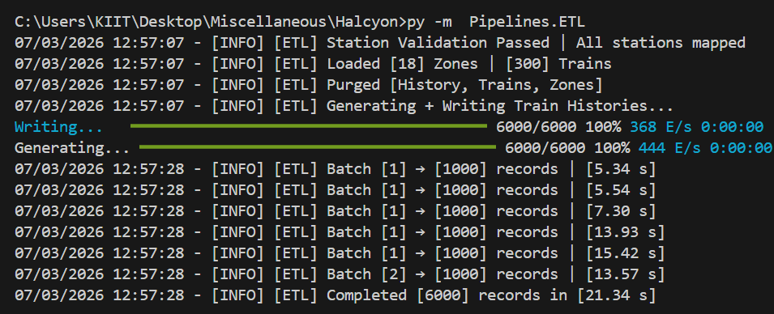
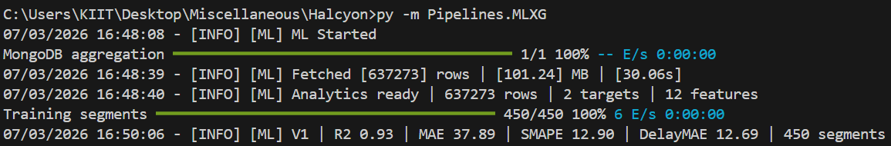
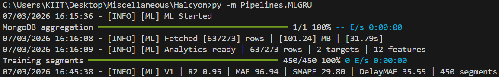
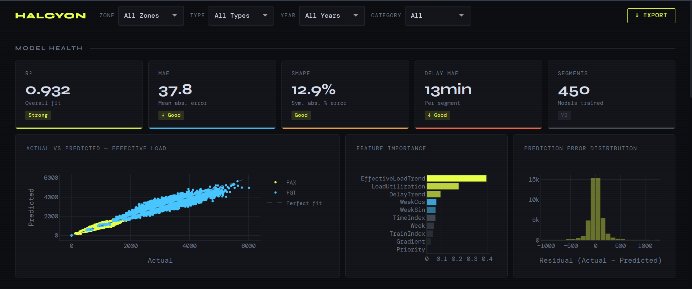
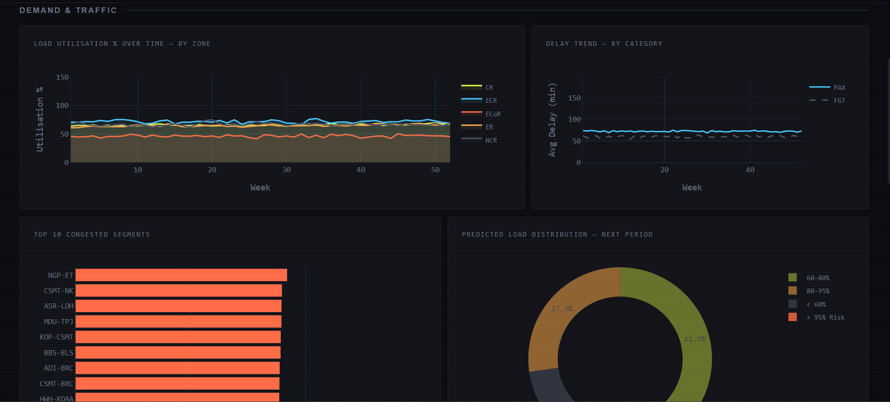
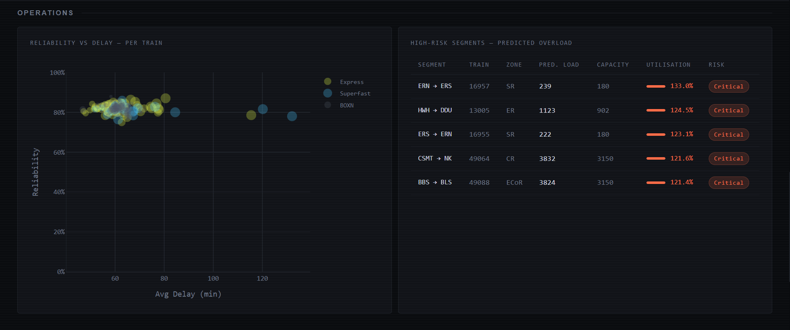
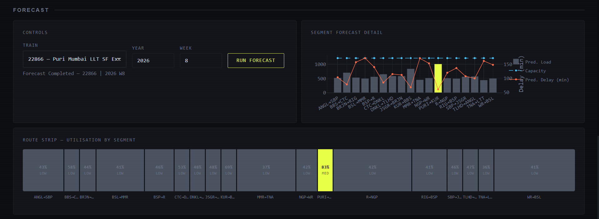

# Halcyon

> In Greek myth, the halcyon was said to sense the coming storm before the sea had any reason to show it. This system operates on the same premise — not to observe congestion, but to anticipate it.

Halcyon simulates **300 trains across 18 zones** with **20 years of weekly history**, trains predictive models at the segment level, and surfaces everything through a live analytical dashboard.

The system moves in three acts: **ETL** builds the world, **ML** makes sense of it, and **Halcyon** puts it on the wall.

---

## Architecture at a Glance

```
ETL.py          →    MongoDB (Stratum.History)
                           ↓
MLXG.py / MLGRU.py →    Parquet cache + versioned models
                           ↓
                      Dashboard (localhost:8050)
```

The handoff between stages is deliberate — ETL writes once, ML reads and caches, the dashboard never touches the database directly. Each stage can be run independently once the previous one has produced its output.

| Layer           | Technology                                               |
|-----------------|----------------------------------------------------------|
| Database        | MongoDB Atlas                                            |
| Data Generation | NumPy,   Producer/Consumer Threading                     |
| ML — Trees      | XGBoost, SHAP                                            |
| ML — Sequences  | PyTorch GRU, ThreadPoolExecutor                          |
| Serialisation   | Joblib (XGB) || .pt (GRU) || PyArrow Parquet             |
| Dashboard       | Plotly Dash, Dash Bootstrap Components                   |
| Utilities       | Configuration, Logger (Rich)                             |

---

## ETL — Data Generation

`ETL.py` is a producer/consumer pipeline. The main thread generates 20 years of weekly train history and enqueues it in batches; a pool of writer threads drains those batches into MongoDB concurrently.

**The schema is intentionally flat** — one document per `(TrainNumber, Year)`, with `Weeks → Segments` nested inside. This sidesteps the triple `$unwind` penalty that a fully normalised structure would incur at query time.

Generation is vectorised at the year boundary. For every year, all stochastic draws — demand noise, cancellation counts, delay samples, load flux — are pre-allocated as `(Weeks × tTains)` NumPy arrays in a single pass. The one exception is the per-segment load evolution loop, which is a recurrence relation by nature and runs sequentially by design.

`Reliability`, `Distance`, and `Gradient` are all resolved and denormalized at generation time, not deferred to the ML stage.

```bash
py -m Pipelines.ETL
```


> *Dual progress bars: Generating... and Writing... running concurrently*

---

## ML — Learning the Patterns

Both ML variants share the same ingestion logic. On first run, a MongoDB aggregation pipeline flattens the nested history into a row-per-segment frame, which is then cached as a versioned Parquet. Every subsequent run skips the aggregation entirely and reads from cache. Models are versioned (`V1`, `V2`, ...) and never overwrite previous iterations.

The targets are `EffectiveLoad` and `Delay`, predicted per segment. The feature set spans geometry, temporality, and operational history:

`TimeIndex` · `Week` · `WeekSin` · `WeekCos` · `Distance` · `Gradient` · `Priority` · `TotalCapacity` · `Reliability` · `EffectiveLoadTrend` · `DelayTrend`

Cyclical week encoding (`sin`/`cos`) ensures the model understands that week 52 and week 1 are adjacent. Trend features are per-segment rolling diffs — a lagged signal of momentum.

---

### XGBoost variant

One `XGBRegressor` per segment, with an 80/10/10 train/val/test split and early stopping on validation loss. Feature importance is aggregated across all segment models and stored in the Parquet metadata alongside the evaluation metrics (R², MAE, SMAPE). SHAP explainability is available on demand per segment.

```bash
py -m Pipelines.MLXG
```



---

### GRU variant

A 2-layer GRU network with a 26-week lookback window, trained per segment in parallel across a `ThreadPoolExecutor`. Each segment gets its own model, its own mean/std scaler, and its own drift score — there is no global normalisation, which would bleed variance across segments with fundamentally different load profiles.

```
Input  →  (Batch, 26, Features)
GRU    →  64 hidden units, 2 layers, dropout 0.2
Head   →  Linear → (Batch, 2)
```

Sliding windows are constructed via `numpy.lib.stride_tricks.sliding_window_view` — a single allocation, zero loops. Feature importance is derived through gradient sensitivity rather than SHAP, since TreeExplainer has no jurisdiction over recurrent architectures.

```bash
py -m Pipelines.MLGRU
```



---

## Halcyon — The Dashboard

Both ML variants converge on the same `Dashboard` class, served at the local IP of the system. It is a dark-mode Dash application with a sticky filter header and four analytical sections.

Filters — Zone, Type, Year, Category — are reactive across Demand, Operations, and Forecast sections. The Model Health section is static: it reflects the loaded model version, not the active filter.

---

### Model Health



The diagnostic surface. KPI cards for R², MAE, SMAPE, and Delay MAE with colour-coded severity badges. Below them: an Actual vs Predicted scatter (split by PAX and FGT), a feature importance bar chart for the top 10 contributors, and a residual error distribution histogram.

---

### Demand & Traffic



Load utilisation over time grouped by zone, average delay trends by category, the top 10 congested segments ranked by mean predicted utilisation, and a donut chart distributing all predictions across four risk bands — below 60%, 60–80%, 80–95%, and critical above 95%.

---

### Operations



A reliability vs. delay scatter per train type, where bubble size encodes the number of observations — trains with more history carry more visual weight. Alongside it, a high-risk segment table listing the top 8 segments above 70% utilisation, with inline progress bars and risk classification pills.

---

### Forecast



Select a train, a year, and a week. The model runs inference over that train's segment history and returns predictions for every segment along the route. The route strip renders each segment as a proportional block — width scaled to distance, colour to risk. Below it, a segment chart overlays predicted load bars, a capacity reference line, and predicted delay on a secondary axis.

Filtered views can be exported as JSON from the header at any time.

---

## Environment

```env
MongoURI = mongodb+srv://...   # Mongo Cluster URI
```

---

## A Few Things Worth Knowing

- The segment load recurrence **cannot be vectorised** — each segment's output is the next segment's input. This is a structural constraint, not an oversight.
- `Queue.join()` swallows signals on Windows. The writer drain uses `WriteDone.wait(timeout = 0.2)` in a `finally` block specifically to stay interruptible.
- Drift detection is per-segment. If the maximum drift across all segments crosses the configured threshold, the model retrains automatically before serving predictions.
- The GRU loader reconstructs model instances from state dicts — model objects are never pickled directly.
- The number of PyTorch Threads and Numbers or Cores to use have to be updated as per system need.


---
